<p align="center">
  
</p>

# 고정콕 (Fixpick)

> **고정지출을 콕 집어 확인하다**
> 구독 서비스, 월세, 통신비처럼 흩어진 고정지출을 한곳에서 관리하는 웹 서비스

링크

- 배포 사이트 : [고정콕 바로가기](https://fixpick-beta.vercel.app)
- Figma : [디자인 보기](https://www.figma.com/design/AdH1F4MqDZuF1zycdoRsKx/%EA%B3%A0%EC%A0%95%EC%BD%95?node-id=4-6)
- GitHub: [저장소](https://github.com/114soyeon/Fixpick)

<br>

## 기획 의도

**불편한 점**

- 구독과 고정지출이 여러 곳에서 빠져나가서 무엇이 언제 얼마씩 나가는지 모른다.
- 1년에 한 번 나가는 큰돈(자동차세, 보험 갱신 등)을 놓친다.
- 한 달 고정지출이 정확히 얼마인지 모른다.

**해결 방법**

- 매달 나가는 돈을 한 화면에서 볼 수 있도록 등록한다.
- 결제일 전에 알림을 받을 수 있고, 캘린더로 일정을 확인 할 수 있다.
- 월간·연간 리포트로 나의 지출 흐름을 확인 할 수 있다.

<br>

## 프로젝트 정보

| 구분      | 내용                                        |
| --------- | ------------------------------------------- |
| 기간      | 2026.11.02 ~ 2026.11.27 (약 1개월)          |
| 팀 구성   | 4명 (UI/UX 디자인 3명, 프론트엔드 개발 1명) |
| 디자인 툴 | Figma                                       |
| 협업 툴   | Slack, GitHub, Figma, Google 스프레드시트   |

**기술 스택**

| 구분       | 사용 기술                   |
| ---------- | --------------------------- |
| 프론트엔드 | React, React Query, Zustand |
| DB         | Supabase                    |
| 배포       | Vercel                      |

<br>

## 주요 화면 & 기능

### 0. 회원가입


> 권지원 : 회원가입 화면 디자인, 코딩<br>
> 김소연 : 이메일 인증 기능 구현

### 0. 로그인

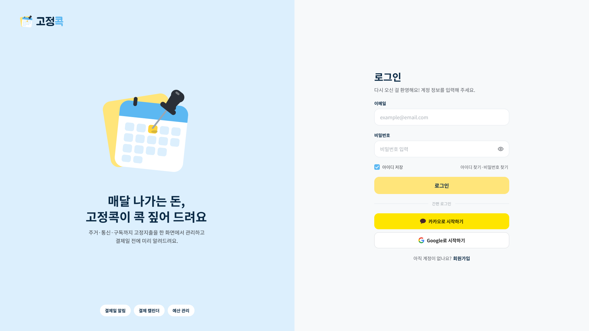

> 권지원 : 로그인 화면 디자인, 코딩<br>
> 김소연 : 아이디 저장, 간편 로그인(카카오, Google 로그인) 기능 구현

### 0-1. 아이디 찾기, 비밀번호 찾기

<p>
  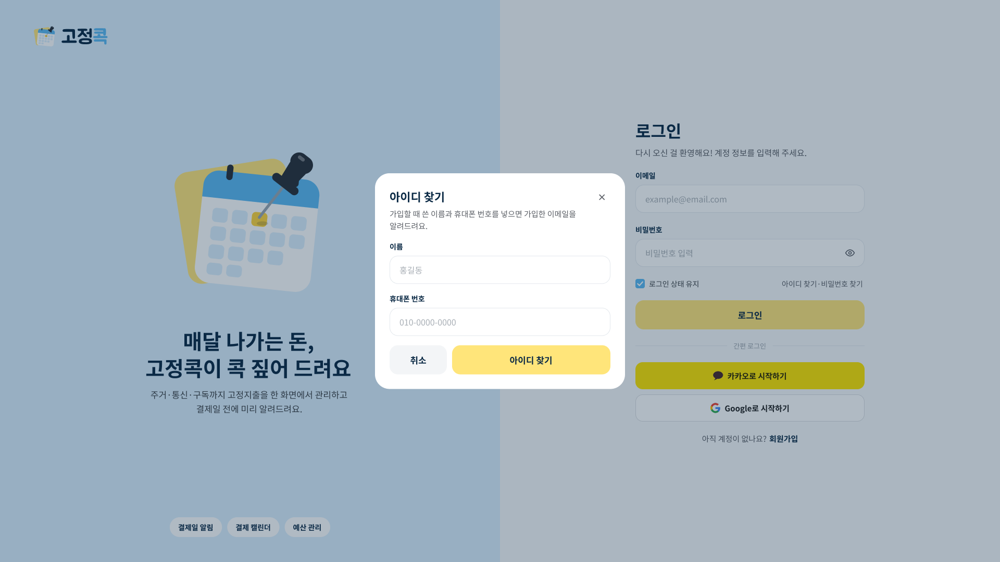
  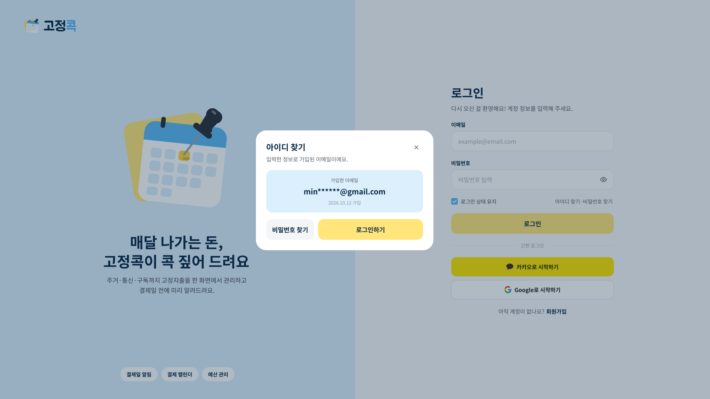
  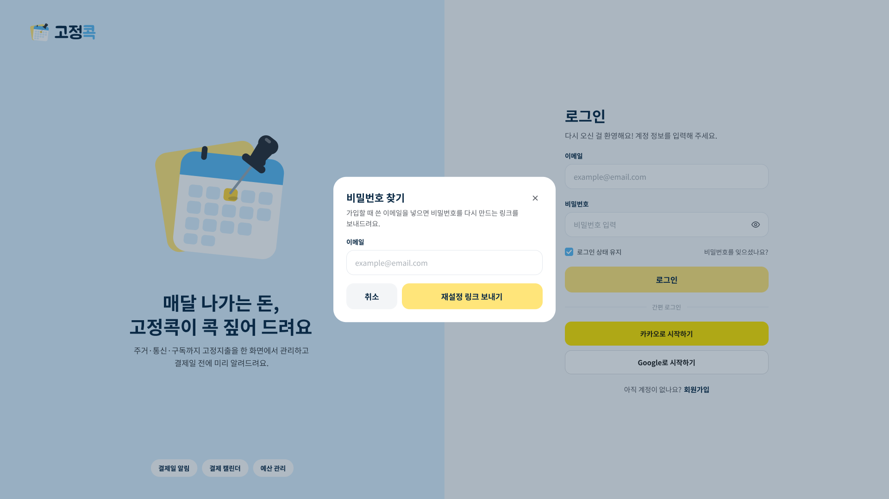
</p>

> 권지원 : 아이디 찾기, 비밀번호 찾기 화면 디자인, 코딩<br>
> 김소연 : 아이디 찾기, 비밀번호 찾기 기능 구현


### 1. 홈 (대시보드 + 사이드바)

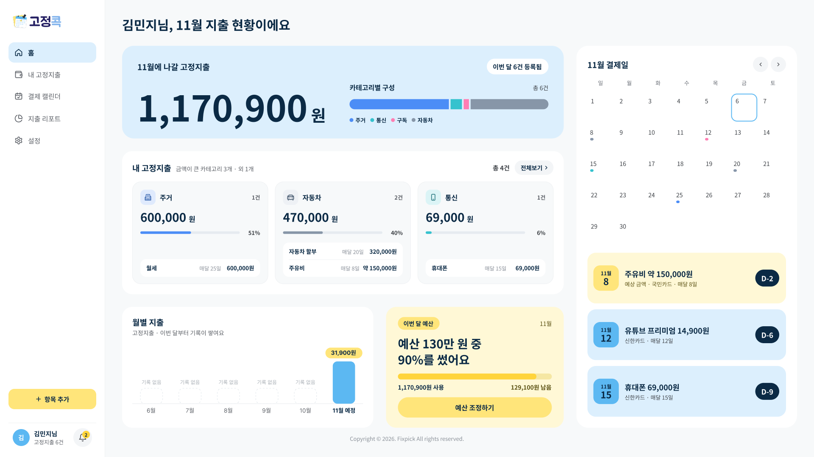

> 권지원 : 메인 대시보드, 공통 사이드바, 알림 패널 디자인, 코딩

- 이번 달 나갈 금액 : 총액과 카테고리 구성
- 내 고정지출 : 금액이 큰 카테고리부터 표시
- 월별 지출과 예산 : 지출 추이와 예산 사용량
- 이달의 결제일 : 달력과 다가오는 결제 D-day

### 2. 항목 추가

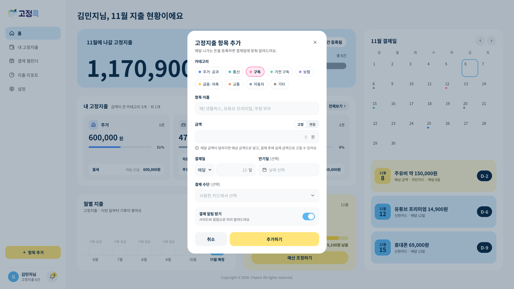

> 권지원 : 항목 추가 화면 디자인<br>
> 김소연 : 항목 추가 Supabase 연동

- 항목 입력 : 카테고리, 이름, 금액, 결제일, 만기일
- 결제 수단 선택 : 등록해 둔 카드나 계좌에서 선택

### 3. 내 고정지출

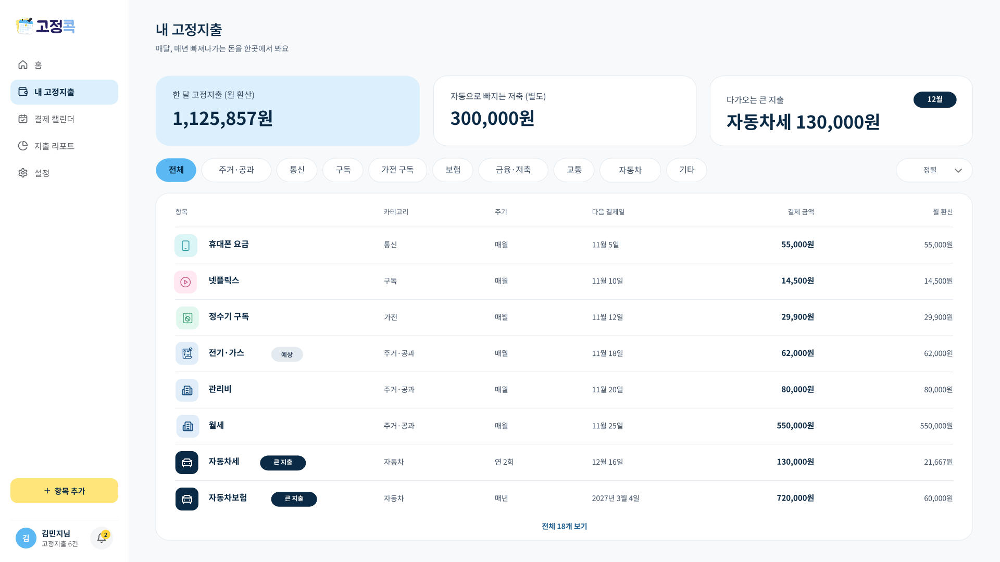

> 변예담 : 요약 카드, 표 영역 무한 스크롤<br>
> 김소연 : 추가, 필터 정렬, 다음 결제일 계산 기능 구현

- 요약 : 한 달 고정지출, 자동으로 빠지는 저축, 다가오는 큰 지출
- 필터·정렬 : 카테고리별 보기와 정렬
- 항목 표 : 주기, 다음 결제일, 월 환산액, 큰 지출 태그

### 3-1. 내 고정지출 세부 페이지 (+ 결제 정보 수정 모달)

<p>
  
  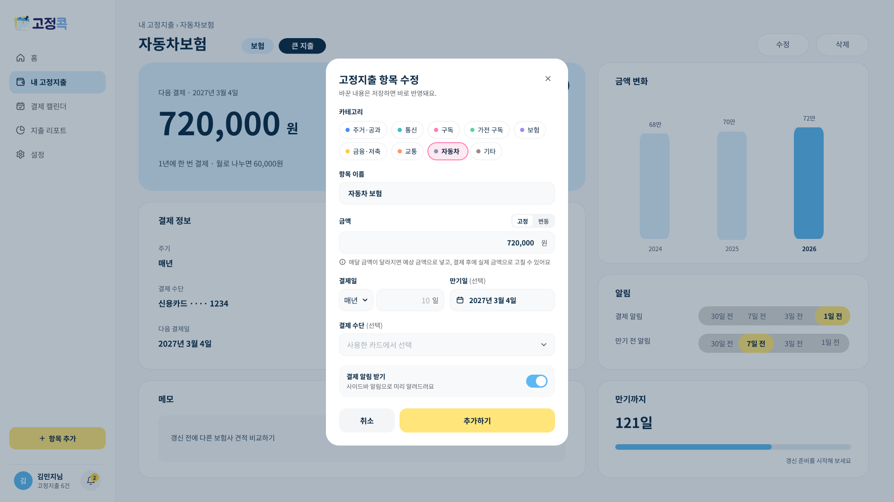
</p>


> 변예담 : 세부 페이지, 결제 정보 수정 모달 디자인, 코딩, 바로 저장되는 메모 기능 구현<br>
> 김소연 : 결제 정보 수정, 삭제 데이터 연동 기능 구현

- 상세·수정: 결제 정보, 금액 변화, 알림, 만기까지 남은 날

### 4. 결제 캘린더


> 나혜진 : 디자인 화면, 데이터 연결

- 월간 달력 : 날짜별 결제를 아이콘과 이름으로 표시
- 남은 결제 : 이번 달 남은 금액과 진행 상황
- 선택한 날 : 그날의 결제 항목과 합계
- 큰 지출 미리 보기 : 자주 나가지 않아 놓치기 쉬운 결제

### 5. 지출 리포트
<p>
  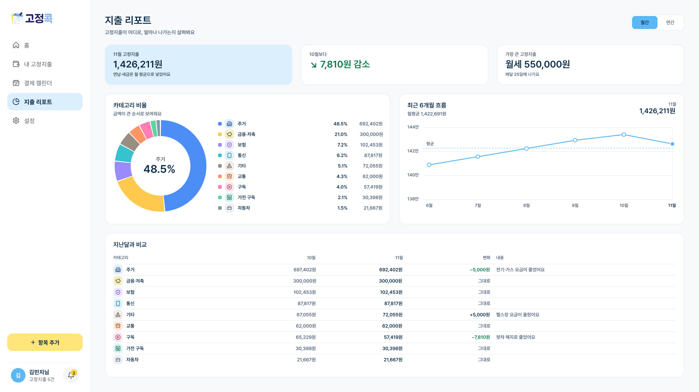
  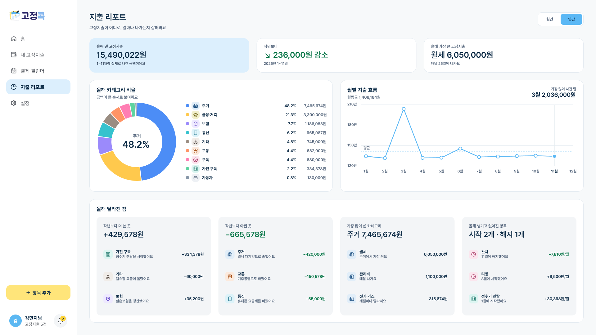    
</p>

> 나혜진 : 지출 리포트 디자인, 코딩, 데이터 연결

- 월간 : 이번 달 현황, 카테고리 비율, 지난달 비교
- 연간 : 올해 지출, 월별 흐름, 작년과 달라진 점

### 6. 설정

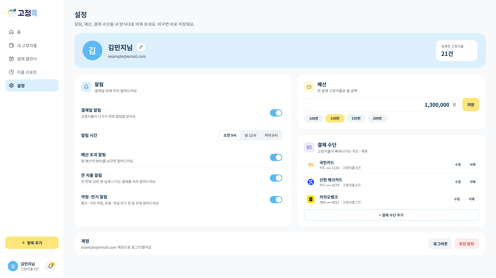

> 나혜진 : 설정 화면 디자인, 코딩<br>
> 김소연 : 알림 설정 연동, 예산

- 설정 : 알림(결제일, 예산 초과, 큰 지출, 약정·만기), 한 달 예산, 카드·계좌 등록

### 6-1. 결제 수단 모달

<p>
  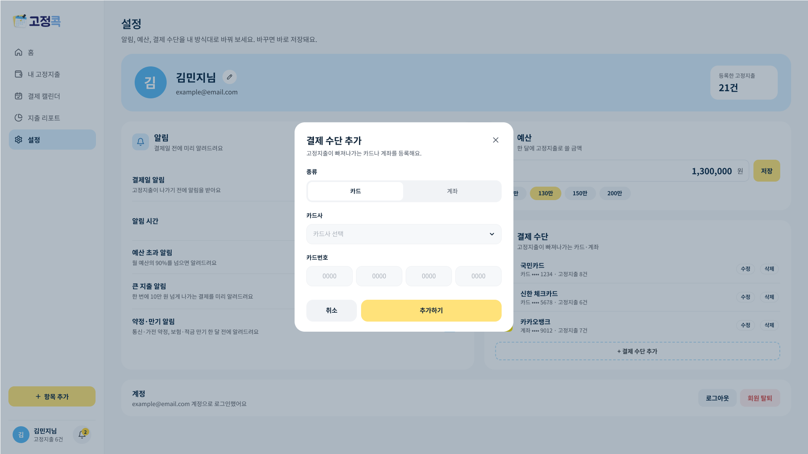
  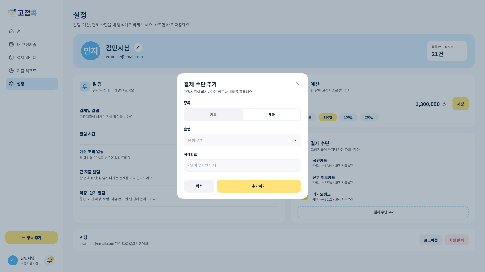
  </p>


> 나혜진 : 결제수단 추가 모달 디자인 화면<br>
> 김소연 : 결제 수단 추가, 수정, 삭제 기능 구현

<br>

## 팀원별 역할

**프론트엔드**
- 김소연 ([@114soyeon](https://github.com/114soyeon)) : 인증·로그인, Supabase DB·RLS 설계와 연동, Vercel 배포

**UI/UX 디자인**
- **권지원** ([@alice207116116-debug](https://github.com/alice207116116-debug)) : 로그인·회원가입, 아이디·비밀번호 찾기, 홈, 사이드바, 항목 추가 모달
- **변예담** ([@yeadm](https://github.com/yeadm)) : 내 고정지출, 고정지출 상세, 결제 수단 변경 모달
- **나혜진** ([@nahj272](https://github.com/nahj272)) : 결제 캘린더, 지출 리포트, 설정, 카테고리 컬러 규칙

<br>

## 협업 방식

- 화면별로 담당을 나누고, 디자이너도 맡은 화면을 직접 구현
- Slack으로 매일 진행 상황·막힌 부분·병합 일정 공유, 정할 일이 생기면 바로 회의
- 맡은 부분은 팀원들에게 의견을 구해 보완
- 할 일과 일정은 각자 Google 스프레드시트로 관리
- 디자인은 Figma 파일 하나에서 함께 작업
- 개인 브랜치에서 작업 → `api` 브랜치에서 확인 → `main`에 병합
- 큰 정리 작업은 병합 직후 진행 후 Slack으로 공유

<br>

## 트러블 슈팅

### 김소연 (114soyeon)

 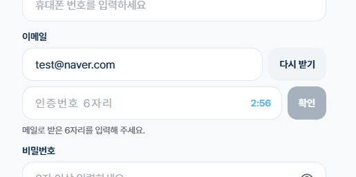


```js
// /api/send-codes.js
const transporter = nodemailer.createTransport({
  host: "smtp.gmail.com",
  port: 465,
  secure: true,
  auth: { user: gmailUser, pass: gmailPass },
});
await transporter.sendMail({
  from: `"고정콕" <${gmailUser}>`,
  to: email,
  subject: "고정콕 가입 인증번호",
  html: `
    <p>고정콕 가입 인증번호는 아래입니다.</p>
    <p style="font-size:28px;letter-spacing:8px;"><b>${code}</b></p>
    <p>3분 안에 입력해 주세요.</p>`,
});
```

**어려웠던 점**

- 외부 서비스 연동: 코드 로직은 완성했는데 실제 환경에서 계속 실패했다. 공식 SMTP 제한 때문에 메일이 오지 않았고, 배포 후에는 비밀번호 재설정 링크가 404, API가 405/502를 냈다. 카카오 로그인은 KOE205 오류가 났고, 구글은 앱 게시 버튼이 눌리지 않았다.

**해결 방법**

- HTTP 상태 코드와 에러 코드(KOE205, otp_expired)를 단서로 원인을 좁혀 갔다. 메일은 Vercel 서버리스 함수에서 직접 보내도록 바꿨고, 재설정 링크 404는 vercel.json rewrite로 해결했다. 카카오는 추가 기능 신청과 도메인 승인을 받았고, 구글은 데이터 액세스 범위와 개인정보처리방침 URL을 등록하고 Search Console 확인을 마친 뒤 게시했다.

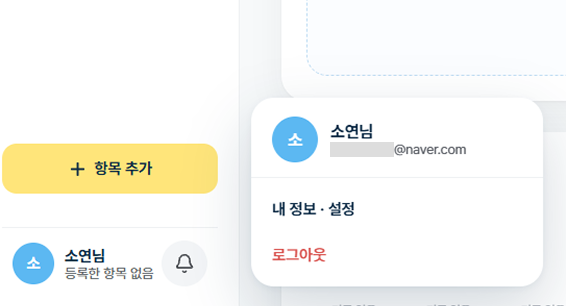

```js
// /src/components/Layout.jsx
useEffect(() => {
  const stop = onAuthChange((session) => setAuth(session));
  return stop;
}, [setAuth]);

useEffect(() => {
  const id = user?.id;
  if (prevUserId.current === id) return;
  const wasLoggedIn = !!prevUserId.current;
  prevUserId.current = id;
  if (wasLoggedIn) queryClient.clear();
}, [user?.id, queryClient]);
```

**어려웠던 점**

- 목업 데이터 걷어내기: 화면은 완성됐지만 대부분 목업과 localStorage 데이터였다. Supabase로 바꾸자 RLS 때문에 데이터가 읽히지 않았고, 로그아웃해도 대시보드가 비워지지 않았으며, 페이지를 이동하면 로그아웃됐다.

**해결 방법**

- 인증 상태는 authStore 하나로 통일하고, 서버 상태는 React Query로 분리했다. 로그아웃할 때는 페이지만 이동하지 않고 queryClient.clear()로 캐시도 함께 지웠다. RLS 정책과 API select 컬럼도 다시 정리했다.

<br>

**배운 점**
- 외부 연동은 코드보다 설정과 승인에서 막혔다. 실제 서비스는 대시보드 설정, 검증, 승인 단계에서 멈춘다.
- 화면이 동작하는 것과 데이터가 연결되는 것은 다른 문제다. 목업으로 완성한 화면은 아직 구현이 끝난 게 아니다.
- 상태는 종류별로 나눠야 한다. 인증, 서버, UI 상태를 한곳에 섞으면 로그아웃과 캐시 문제가 다시 생긴다.


### 권지원 (alice207116116-debug)
<p>
  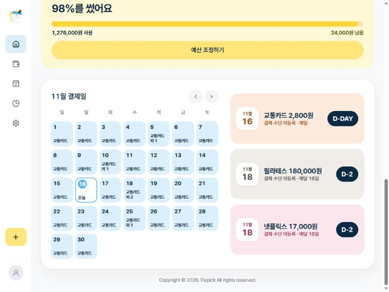
  
</p>

**어려웠던 점**

- 홈 화면 결제 달력에 '매일' 결제를 하나 등록했더니 달력의 모든 칸이 결제일 색으로 칠해졌다. 다른 결제는 '교통카드 외 1'처럼 한데 묶여 보여서, 무엇이 언제 나가는지 알기 어려웠다.

**해결 방법**

- 칸 배경색과 결제 이름을 빼고, 그날 나가는 항목마다 카테고리 색 둥근 밑줄을 날짜 아래에 하나씩 그렸다. 이제 며칠에 어떤 카테고리가 몇 건 나가는지 한눈에 보인다.

<p>
  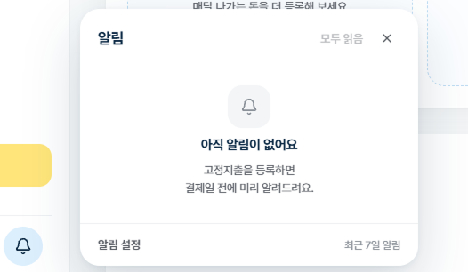
  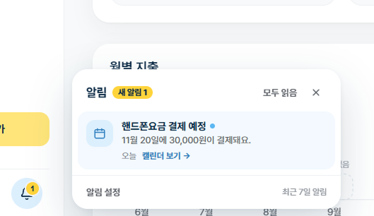
</p>

**어려웠던 점**

- 사이드바 알림이 하나도 뜨지 않았다. 고정지출을 등록하고 결제일이 코앞이어도 알림창은 계속 비어 있었다. 알고 보니 알림은 예전에 쓰던 브라우저 저장소(localStorage)에서 항목을 읽고 있었는데, 항목은 이미 DB에 저장되도록 바뀐 상태였다. 그래서 알림은 늘 빈 목록을 보고 있었다.

**해결 방법**

- 알림도 DB에 저장된 항목을 읽도록 바꿨다. 그러면서 항목마다 정해 둔 알림 시점과 알림 켜기/끄기 설정이 실제로 반영되게 하고, 설정 페이지에서 알림 종류를 끄면 그 알림은 뜨지 않게 했다. 예산 초과 알림도 설정에 저장한 예산을 기준으로 계산하게 했다.


**배운 점**

- 매일 나가는 결제처럼 자주 반복되는 데이터까지 고려해야 화면이 복잡해지지 않는다.
- 기능 하나만 바꿔도 그 데이터를 쓰는 다른 곳까지 같이 확인해야 한다는 걸 배웠다. 항목 저장 위치를 DB로 옮기면서 알림 쪽은 미처 신경 쓰지 못했고, 에러도 안 나서 한동안 문제인 줄 몰랐다. 그 뒤로는 데이터 구조를 바꿀 때 그 데이터를 어디서 읽는지부터 찾아보고, 화면에 실제로 잘 나오는지도 직접 확인하고 있다.


### 변예담 (yeadm)
<p>
  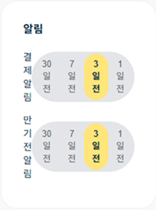
  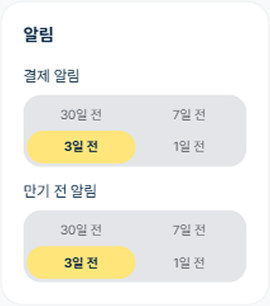
</p>

**어려웠던 점**

- 고정지출 목록은 6칸 표(항목·카테고리·주기·다음 결제일·금액·월 환산)였다. 375px 화면에서는 사이드바를 빼면 본문 영역이 작아져 카드들의 정렬이 보기 좋지 않았다.

**해결 방법**

- 화면을 줄이기만 해서는 해결되지 않았고, 사용자의 시선에서 보기 좋게 375px의 사이즈일 때를 재배치하는 것이 필요하다고 생각했다. 화면을 둘로 나누어 알림과 만기일 부분을 나란히 배치하여 화면이 비어 보이지 않으면서도, 사용자에게 쉽게 전달되게 수정하였다.

**배운 점**

- 반응형은 화면을 ‘줄이는’ 작업이 아니라 ‘다시 구성하는’ 작업이었다. 좁은 화면에서는 레이아웃이 바뀌면 빈 공간의 균형도 다시 봐야 하고, 정보의 균형이 잘 이루어지게 사용자에게 전달되는가를 생각해보는 계기가 되었다.


### 나혜진 (nahj272)
<p>
  
  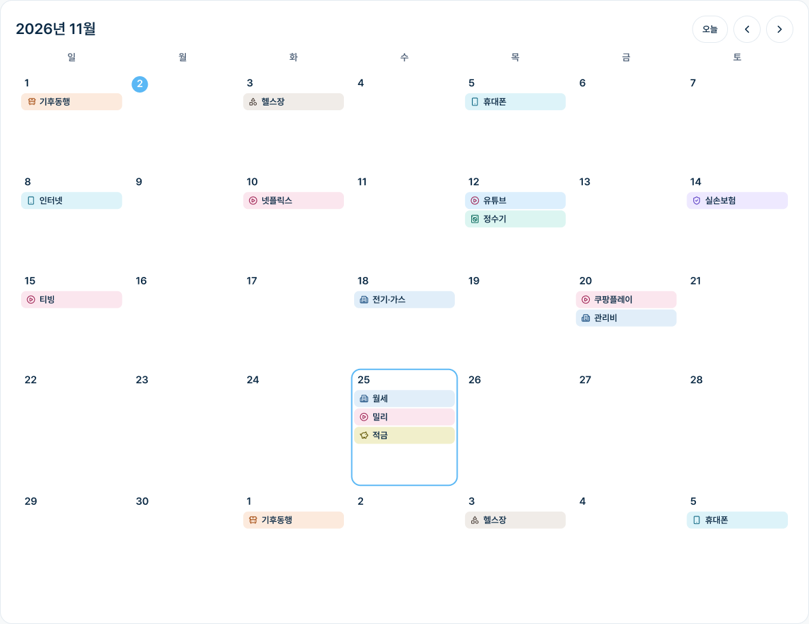
</p>

**어려웠던 점**

- 결제 캘린더의 칩이 모두 같은 연한 파란색이고 아이콘도 11px로 작아서, 어떤 카테고리의 결제인지 구분할 수 없었다.

**해결 방법**

- 아이콘을 14px로 키우고, 칩 배경을 DB에 저장한 카테고리별 연한 색으로 칠했다. 이제 칩 색과 아이콘만 보고도 카테고리를 구분할 수 있다.

**배운 점**

- 디자인에서 정한 카테고리 색 규칙을 실제 화면까지 그대로 적용해야 사용자가 한눈에 알아볼 수 있다.


<br>

---

## 부록

### 정보 구조 (IA)

```
로그인 ─┬─ 회원가입
        ├─ 아이디 찾기 · 결과
        └─ 비밀번호 찾기

사이드바 메뉴
├─ 홈 ─────────── 항목 추가 ── 결제 수단 선택
├─ 내 고정지출 ── 상세 ── 결제 정보 수정
├─ 결제 캘린더
├─ 지출 리포트 ── 월간 / 연간
└─ 설정 ───────── 결제 수단 추가 ── 카드 · 계좌
```

### 카테고리

모든 화면에서 같은 색과 아이콘으로 표시합니다.

| 카테고리                                                               | 색        | 포함 항목                                          |
| ---------------------------------------------------------------------- | --------- | -------------------------------------------------- |
|  주거·공과           | `#154A7D` | 월세, 관리비, 전기·가스·수도, 주담대·전세대출 이자 |
|  통신            | `#0A6480` | 휴대폰 요금·할부, 인터넷·IPTV, 가족 결합, 알뜰폰   |
|  구독              | `#9E2152` | 영상, 음악·오디오, 클라우드·툴, 쇼핑 멤버십, 게임  |
|  가전 구독 | `#0C6B5E` | 정수기, 공기청정기, 세탁기, 식기세척기 등          |
|  보험           | `#5B3FC4` | 실손·건강·암, 자동차·운전자, 종신·연금             |
|  금융·저축 | `#5E5300` | 적금, 청약, 연금저축·IRP, 펀드, 대출 원리금        |
|  교통          | `#A04508` | 대중교통 정기권, 모두의 카드(K-패스), KTX 정기권   |
|  자동차          | `#536579` | 유류비, 자동차세, 유지비, 자동차 할부, 주차비 등   |
|  기타              | `#4E433C` | 경조사비, 세금, 헬스·관리, 반려동물 등             |

### 디자인 규칙

**색의 역할**

| 색        | HEX       | 역할                        |
| --------- | --------- | --------------------------- |
| 하늘      | `#5CB8F2` | 선택 상태, 오늘 날짜        |
| 연한 하늘 | `#DCEFFD` | 강조 카드, 선택한 메뉴 배경 |
| 노랑      | `#FFE57A` | 주요 버튼, 배지             |
| 초록      | `#067647` | 지출 감소                   |
| 네이비    | `#0B2A45` | 제목, 숫자                  |

**레이아웃**

- 화면 규격: 1920 × 1080
- 사이드바: 248px
- 내용 패딩: 40px
- 카드 간격: 24px

**글꼴·아이콘**

- 글꼴: Pretendard, Noto Sans
- 아이콘: Lucide

### DB 구조


| 테이블               | 역할                     | 주요 컬럼                                                                                                                              |
| -------------------- | ------------------------ | -------------------------------------------------------------------------------------------------------------------------------------- |
| `users`              | 회원 정보                | name, phone, is_active, is_alarm                                                                                                       |
| `subscriptions`      | 등록한 고정지출 항목     | category_id, name, amount, cycle, amount_type, payment_method_id, start_date, expiry_date, payment_alert_days, expiry_alert_days, memo |
| `categories`         | 카테고리 이름·아이콘·색  | name, icon, color, bg, chart                                                                                                           |
| `payments`           | 결제 기록                | subscription_id, due_date, amount                                                                                                      |
| `payment_methods`    | 등록한 카드·계좌         | payment_id, last4                                                                                                                      |
| `payment_categories` | 카드사·은행 목록         | type, name, icon                                                                                                                       |
| `budgets`            | 월 예산                  | month, amount, category_id                                                                                                             |
| `notifications`      | 알림 내역                | subscription_id, title, body, is_read                                                                                                  |
| `user_settings`      | 알림·예산 설정           | payment_alert_enabled, budget_alert_rate, large_expense_threshold, expiry_alert_enabled                                                |
| `email_codes`        | 회원가입 이메일 인증번호 | email, code, attempts                                                                                                                  |

### 폴더 구조

```
src
├─ pages        # 화면 (홈, 내 고정지출, 캘린더, 리포트, 설정, 로그인, 회원가입)
├─ components   # 화면별 컴포넌트 (add-item, calendar, report, setting, sidebar, signup)
├─ api          # Supabase 요청 함수 (인증, 고정지출 등)
├─ queries      # React Query 데이터 불러오기
├─ store        # Zustand 로그인 상태
├─ hooks        # 공통 훅
├─ constants    # 카테고리, 카드 로고 등 고정 데이터
├─ utils        # 날짜·금액 포맷, 인증, 리포트 계산 등
├─ lib          # Supabase 연결
├─ styles       # 화면별 CSS
├─ router.jsx   # 페이지 경로
└─ main.jsx
```
